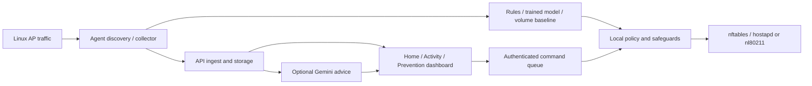

# CasaWarden

CasaWarden is a home-network security prototype: a Linux hotspot agent discovers
clients, measures traffic, detects selected scan behaviors, and can restrict network
access. A React dashboard shows reported risk, activity, presence, and recovery
controls. Gemini provides optional explanations and advice; it does not authorize
firewall actions.

Reviewed against `main` at `332f573` on November 15, 2026. See the
[post-9 p.m. commit/PR review](docs/RECENT_CHANGES.md) for changes, verification,
and known integration gaps.

## Project name and compatibility

CasaWarden was previously called SecurIoT. Keep existing implementation names
unchanged when copying commands: `securiot_agent`, `securiot_ml`, `securiot-agent`,
`SECURIOT_*`, the `securiot` schema/Compose project, browser storage keys,
`securiot_guard` firewall tables, and their ownership markers. `/etc/securiot`
and `/var/lib/securiot` remain valid paths. Some UI/API labels still use SecurIoT;
renaming those identifiers requires a separate compatibility change.

## Run the dashboard

Configure `.env` or `api/.env` using [deployment setup](deploy/README.md), then:

```bash
docker compose up --build -d
```

Open [http://localhost](http://localhost), using default HTTP port 80. Caddy
proxies the dashboard and `/api`. Current Compose runs Vite against the mounted
`web/` source; it does not serve a prebuilt production bundle. The browser uses
the live API even under `npm run dev`; mock flags no longer enable a browser demo.
Sign in with a provisioned judge/admin account. Invitation signup is not wired
in this revision despite the example environment variable and signup UI.

See [verification and remaining gaps](docs/RECENT_CHANGES.md#verification-and-known-gaps)
for the current checkout.

## Current behavior

- **Inventory and identity:** live discovery uses captured source addresses,
  DHCP/neighbor data and AP station information. Vendor/type hints are inferred,
  and private MACs limit attribution. The live agent supports up to 20 devices.
- **Presence:** announced departures use a 3-second grace; silent absence uses
  15 seconds after it is observed. Joins/packets can restore presence immediately.
  Quiet associated clients are listed even before sending a packet.
  Offline clients move from Home to Activity's Older Devices. A quarantine or
  WAN restriction takes precedence over offline presentation.
- **Detection:** trained binary scan warnings, strong ARP/decoy rules, explicit
  volume calibration, and expiring behavioral risk. Model-only and volume
  findings are advisory. This does not establish broad malware detection.
- **Containment:** the opt-in Linux backend supports WAN block, quarantine,
  Restore, Restore all, durable recovery and local panic. The router must own the
  routed Wi-Fi AP. NetworkManager/nl80211 mode uses repeated station removal,
  rather than a hostapd admission deny list. Replay/simulation use mocks; Bluetooth/power cycling are absent.
- **Manual controls:** Warn records an informational audit entry; Block Internet,
  Quarantine and Restore request agent actions. Manual containment can override
  learning mode and automatic timers, while protected targets and disabled policy
  steps remain guarded. Arm controls automatic response.
- **Gemini:** event explanations, device advice/chat, prioritization and grounded
  public-document research. Installed firmware, credentials and CVE applicability
  remain unknown unless established separately. Provider calls share a persistent
  daily budget/cache; local rules remain available without Gemini.



## Documentation

| Guide | Purpose |
| --- | --- |
| [Project reference](docs/PROJECT_DESCRIPTION.md) | Architecture, evidence boundaries and demo narration |
| [Recent changes](docs/RECENT_CHANGES.md) | PRs #16–20, direct commits and current verification |
| [Deployment](deploy/README.md) | Compose, accounts, migrations, Gemini state and diagnosis |
| [Agent](agent/README.md) | Replay, discovery, presence and testing |
| [Linux enforcement](agent/LINUX_ENFORCEMENT.md) | Real AP controls and recovery |
| [Pi controls status](docs/PI_DIRECT_CONTROL.md) | Current queued/waiting path and unwired direct listener |
| [Dashboard](web/README.md) | Navigation, controls, connection and build behavior |
| [Contract](contract/README.md) | Telemetry, snapshots, commands and advisor endpoints |
| [Threat coverage](agent/THREAT_COVERAGE.md) | Supported signals, vulnerability provenance and limits |

The risk score is an evidence-based review aid, not an infection probability.
A blocked connection does not repair a device, and Restore does not establish
that it is safe. Test only on authorized devices and networks.
