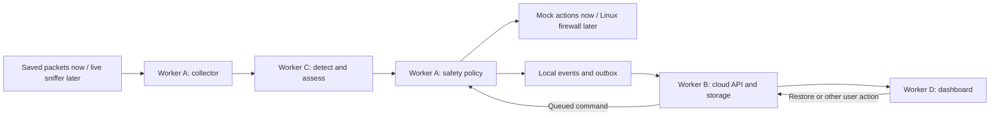

# Where this agent fits

## Stage after packet replay

We have a **standalone offline agent component**: actual packet-file decoding,
per-device traffic measurements, Worker C detection/scoring, safety decisions, mock
enforcement, restart state, and an audit/outbox. Generated capture fixtures make
the whole chain reproducible on a development laptop.

This is a collection/core milestone, not completion of Worker A's network track.
Live discovery/capture, the Linux AP/firewall, cloud delivery, and the local web
server still need implementation and integration tests.

The C/B/D boxes show the intended seams. The replay CLI now calls Worker C's actual detector and scorer locally and ends
at the outbox. The preview is available only by explicit selection. Cloud
services remain pending.

## Worker C integration status: connected for offline replay

`ml_adapter.py` imports the real `securiot_ml.detect.Detector` and `assess()`.
The replay CLI defaults to `--detector ml`; `--detector preview` selects legacy
behavior. Combined tests live in `tests/test_ml_integration.py`.

The collector adds explicit per-packet `packet_arp_requests` and
`packet_syn_targets` fields. C receives those deltas rather than rolling totals,
and maintains its own window. The adapter aligns C's public `t0` with the replay
session clock and keeps its warmup enabled. Protected MACs are supplied to C's
ignore list as well as guarded by the agent.

C marks target scans as supporting evidence: they are recorded without automatic
action. Only `scan_arp` and `decoy_touch` with anomaly ≥0.5 can request containment;
the agent still applies learning mode, protection, cooldown, and restore grace.
Raw packet replay doesn't configure decoy hits yet, and cached baselines aren't
automatically enabled until their byte intervals are agreed.

Assessments use C's native anomaly ratio and retain the maximum observed ratio
for this offline session. Static risk factors come from explicit device config;
targeted destination ports are never treated as open services on the sender.
C's native confidence labels are shown locally; conversion to the cloud enum,
score decay, and score persistence remain future integration decisions.

## Worker C: the brain, called locally

The agent supplies device facts and observations. Worker C supplies the real
detector and `assess()` results (risk, band, confidence, reasons). Their package
runs inside the agent process, so local decisions don't require a cloud round trip.

Our raw packet boundary is `PacketRecord` in `packets.py`; the collector's local
output is `Observation` in `models.py`. `bytes_in`/`bytes_out` are per-packet deltas.
ARP counts, unique SYN targets, DNS names, and `window_bytes_*` are current-window
snapshots. The distinction prevents double-counting.

The current adapter follows C's delta-based callable interface. The preview is
kept as an explicit regression mode, and C's package supplies all integrated scores.

## Worker B: the shared contract and cloud

The source of truth now exists at `contract/schemas.json`, `fixtures.json`, and
`README.md`. Planned agent routes are:

- `POST /ingest`: device snapshots and detection events, authenticated with `X-API-Key`.
- `GET /sync?etag=...`: policy plus queued commands, polled every two seconds.
- `POST /commands/{id}/ack`: acknowledge the actual outcome after validation/enforcement.

These business routes are not implemented by this agent. Before connecting them,
build a serialization adapter and validate its batches against the shared schema:

| Local representation today | Required integration behavior |
| --- | --- |
| `status: blocked` | Export `wan_blocked`; keep persisted local state migration explicit if renaming |
| Numeric `last_seen` | Export a UTC ISO-8601 timestamp |
| C assessment in a local dictionary | Export required fields and translate C confidence labels to the contract enum |
| Local `protected` and `dns_queries` fields | Keep them local or map through agreed policy/evidence; Device forbids extra fields |
| Local event `kind: detection` | Export the actual supported finding, e.g. `scan_targets` or `scan_arp` |
| Top-level `simulated: true` on local events | Put replay provenance in `evidence`; Event forbids extra top-level fields |
| Mode-change/restore/restart audit events | Keep local until B defines their write path; they aren't allowed detection kinds |
| Replay/mock outcomes | Explicitly identify simulation; never claim a real firewall action occurred |

Retain each event's UUID and timestamp on retries. Remove an outbox entry only
after an acknowledged ingest result. A command being received isn't proof it was
applied. Unknown commands and unknown/protected MACs must remain guarded locally.

The current contract has four actions: `block_wan`, `quarantine`, `restore`, and
`restore_all`. The earlier plan's `power_cycle` isn't in v3.2; this build rejects it.
Local warmup/cooldown/grace floors and protected-device safeguards remain agent
responsibilities when cloud policy is added.

## Worker D: dashboard and exercise traffic

The cloud dashboard consumes B's API. User actions go through B's command queue
and back to the agent. D's simulator and attack script exercise the system; the
packet fixtures here exercise A's collector specifically. They are different tools.

Later A serves D's compiled React bundle and compatible local API at `:8787` for
offline use. Packet replay currently uses terminal output, not that web server.
Gemini explanations are cloud-side and never decide whether to contain a device.

## Linux: replace the hardware-specific boundaries

Feed the collector from a Scapy live-sniffer callback and replace `MockEnforcer`
with an nftables backend. The safety/runtime and cloud adapters remain shared.
Then verify the real access point, traffic visibility, block/restore behavior,
panic recovery, and offline operation on Linux. Packet replay cannot prove any
of those hardware properties.
