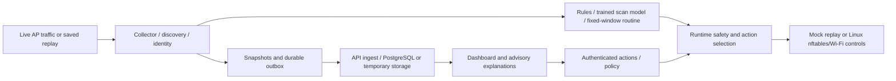

# Agent integration and ownership

Reviewed at `332f573` (November 15, 2026); see [recent commits/merges](../docs/RECENT_CHANGES.md).

| Track | Current responsibility |
| --- | --- |
| A — `agent/` | Live discovery/identity/presence, collection, C adapter, safety/runtime, Linux controls, outbox/sync/ack |
| B — `api/`, `deploy/`, `contract/` | JWT auth, schema/storage, telemetry, policy/commands, audit, advisor services and Compose |
| C — `ml/` | Scan model/window/rules, risk weights/catalog, optional Gemini helpers and offline digest |
| D — `web/` | Home/Activity/Prevention, evidence/research views, policy and manual access controls |

## Current boundaries

`PacketRecord` is the packet-decoding boundary. `Observation` contains per-packet
byte/ARP/SYN/decoy deltas and rolling window snapshots; feeding snapshots as deltas
would double-count activity. `MLAdapter` uses C's actual detector and assessor,
while the trained path selects the artifact's saved feature order and cadence.
Fixed-duration volume detection/risk expiry belongs to `routine.py`, not C's
per-packet byte baseline path.

Model-only and volume findings remain advisory. Eligible strong ARP/decoy rules
can request direct quarantine, with WAN-block fallback if allowed. Other eligible
score-based findings use the runtime tier thresholds. Display risk/AI delta is
not an enforcement score.

The live CLI requires Linux enforcement/discovery and rejects device fixtures.
Discovery can register at most 20 clients and updates the collector/enforcer.
Inferred identity and observed listening ports are labeled separately from
reported firmware/credentials and catalog applicability.

Presence is independent of restriction state: 3-second announced-leave grace,
15-second silent-absence grace after observation, association/source traffic for
return, and no offline assertion when station information is unavailable.
`snapshot_at` carries status updates while `last_seen` remains reported observation
time; a quiet association can establish an initial seen time.
`presence.json` and discovery metadata persist relevant last-seen/offline state;
only normal unrestricted clients export as offline.

## API and wire conversion

`contract/schemas.json` is the shared payload specification. Current migration
readiness is **6**, including migration 005 identity/firmware columns and 006
retirement of simulated inventory. The normal server is live-only.

| Local data | Wire behavior |
| --- | --- |
| `blocked` | `wan_blocked` |
| `present=false` with normal status | `offline`; restrictions take precedence |
| Numeric timestamps | UTC ISO strings, snapshot revision separate from observation |
| Identity hints | `identification`, including provenance and protection metadata |
| C confidence labels | Shared `low/medium/high`; local anomaly 0–1 to 0–40 points |
| Detection records | Supported Event kind, immutable UUID/ts and explicit source |
| Audit-only/presence records | Remain local unless represented through a supported event/snapshot |
| Replay simulation | Explicit provenance; rejected by the normal live-only API |

Agent auth uses X-API-Key for ingest, sync and ack. Dashboard JWT controls queue
commands; they do not execute a cloud firewall. Manual actions bypass automatic
learning/timers while explicit protection/enabled steps still apply. Command UUIDs
are journaled before execution; exact ack/upload retries retain their contents.

Normal live polling is scheduled every 0.5 seconds, with error backoff up to
30 seconds and immediate upload scheduling on presence transitions. Unchanged
telemetry can skip ingest while sync continues. `POST /actions?wait=true` waits
for an agent outcome; the direct-listener implementation is not wired end to end.
See [PI_DIRECT_CONTROL.md](../docs/PI_DIRECT_CONTROL.md).

## Remaining acceptance

The physical Linux router must already provide a routed AP, DHCP, forwarding and
NAT as needed. PR #20 supports both hostapd and NetworkManager/nl80211 control;
the latter re-kicks stations and has no admission deny list. Agent-local dashboard/feed hosting, Bluetooth/power cycling,
independent Pi model accuracy, and comprehensive malware coverage are not provided.
PR #18 reports live presence/ingest checks; it is not proof that every radio,
restart, containment or reconnect acceptance test has passed. See the
[Linux runbook](LINUX_ENFORCEMENT.md) and [current verification](../docs/RECENT_CHANGES.md#verification-and-known-gaps).
