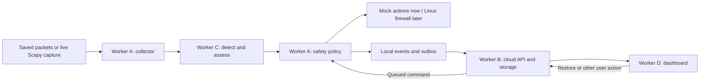

# Where this agent fits

## Current integration stage

We have **replay and live capture with mock enforcement**: packet decoding,
per-device traffic measurements, Worker C rules and trained model, safety decisions,
restart state, and an audit/outbox. Real TCP decoy listeners and an isolated Docker
capture test are available; generated fixtures keep replay reproducible.

This is a collection/core milestone, not completion of Worker A's network track.
Cloud delivery/command polling is implemented for the replay runner. Live cloud
polling, automatic discovery, Linux enforcement, the local web server, and physical
hotspot deployment tests remain pending. See [LIVE_DECOYS.md](LIVE_DECOYS.md).

The C/B/D boxes show the intended seams. The replay CLI now calls Worker C's actual detector and scorer locally and ends
at the outbox. The preview is available only by explicit selection. B's cloud routes and dashboard command creation are verified in an isolated Docker
stack; deployed database verification remains pending.

## Worker C integration status: connected for offline replay

`ml_adapter.py` imports the real `securiot_ml.detect.Detector` and `assess()`.
The replay CLI defaults to `--detector ml`; `--detector preview` selects legacy
behavior. Combined tests live in `tests/test_ml_integration.py`.

The collector adds explicit per-packet `packet_arp_requests` and
`packet_syn_targets` fields. C receives those deltas rather than rolling totals,
and maintains its own window. The adapter aligns C's public `t0` with the replay
session clock and keeps its warmup enabled. Protected devices remain visible to C's detector; the agent prevents automatic
actions against them.

C marks target scans as supporting evidence: they are recorded without automatic
action. Only `scan_arp` and `decoy_touch` with anomaly ≥0.5 can request containment;
the agent still applies learning mode, protection, cooldown, and restore grace.
Raw packet replay accepts explicitly configured TCP decoy IPs. Cached baselines
are not automatically enabled until their byte intervals are agreed. ARP-only
containment also requires eight distinct ARP targets to reduce repeated-gateway false quarantines.

Assessments use C's native anomaly ratio and retain the maximum observed ratio
for this offline session. Static risk factors come from explicit device config;
targeted destination ports are never treated as open services on the sender.
C's native confidence labels are shown locally; conversion to the cloud enum,
score decay, and score persistence remain future integration decisions.

## Worker C: the brain, called locally

The agent supplies device facts and observations. Worker C supplies the real
detector and `assess()` results (risk, band, confidence, reasons). Their package
runs inside the agent process, so local decisions don't require a cloud round trip.

Our raw packet boundary is `PacketRecord` in `packets.py`; the collector's local
output is `Observation` in `models.py`. `bytes_in`/`bytes_out` are per-packet deltas.
ARP counts, unique SYN targets, DNS names, and `window_bytes_*` are current-window
snapshots. The distinction prevents double-counting.

The current adapter follows C's delta-based callable interface. The preview is
kept as an explicit regression mode, and C's package supplies all integrated scores.

## Worker B: the shared contract and cloud

The source of truth now exists at `contract/schemas.json`, `fixtures.json`, and
`README.md`. Planned agent routes are:

- `POST /ingest`: device snapshots and detection events, authenticated with `X-API-Key`.
- `GET /sync?etag=...`: policy plus queued commands, polled every two seconds.
- `POST /commands/{id}/ack`: acknowledge the actual outcome after validation/enforcement.

The optional connected runner calls these routes. `wire.py` converts local records
and `cloud_loop.py` validates each batch before upload:

| Local representation today | Required integration behavior |
| --- | --- |
| `status: blocked` | Export `wan_blocked`; keep persisted local state migration explicit if renaming |
| Numeric `last_seen` | Export a UTC ISO-8601 timestamp |
| C assessment in a local dictionary | Export required fields and translate C confidence labels to the contract enum |
| Local `protected` and `dns_queries` fields | Keep them local or map through agreed policy/evidence; Device forbids extra fields |
| Local event `kind: detection` | Export the actual supported finding, e.g. `scan_targets` or `scan_arp` |
| Top-level `simulated: true` on local events | Put replay provenance in `evidence`; Event forbids extra top-level fields |
| Mode-change/restore/restart audit events | Keep local until B defines their write path; they aren't allowed detection kinds |
| Replay/mock outcomes | Explicitly identify simulation; never claim a real firewall action occurred |

Retain each event's UUID and timestamp on retries. Remove an outbox entry only
after an acknowledged ingest result. A command being received isn't proof it was
applied. Unknown commands and unknown/protected MACs must remain guarded locally.

The current contract has four actions: `block_wan`, `quarantine`, `restore`, and
`restore_all`. The earlier plan's `power_cycle` isn't in v3.2; this build rejects it.
Local warmup/cooldown/grace floors and protected-device safeguards remain agent
responsibilities when cloud policy is added.

## Worker D: dashboard and exercise traffic

The cloud dashboard consumes B's API. User actions go through B's command queue
and back to the agent. D's simulator and attack script exercise the system; the
packet fixtures here exercise A's collector specifically. They are different tools.

Later A serves D's compiled React bundle and compatible local API at `:8787` for
offline use. Packet replay currently uses terminal output, not that web server.
Gemini explanations are cloud-side and never decide whether to contain a device.

## Linux: replace the hardware-specific boundaries

The Scapy live-sniffer callback already feeds the collector. Replace `MockEnforcer`
with an nftables/hostapd backend. The safety/runtime and cloud adapters remain shared.
Then verify the real access point, traffic visibility, block/restore behavior,
panic recovery, and offline operation on Linux. Packet replay cannot prove any
of those hardware properties.

## Connected runner and model handoff

The optional `--connect` runner now serializes and validates records against the
shared schema, calls B's real ingest/sync/ack routes, and journals uploads and
command outcomes for retry. See [CLOUD_RUNNER.md](CLOUD_RUNNER.md). Physical hotspot/Pi tests, live cloud polling,
and deployed database verification remain pending.

Current adapter guards retain protected-device alerts and require multi-host ARP
evidence for automatic quarantine. Vulnerability scoring now uses C's score weights
with agent-side provenance and conservative catalog candidates; see
[THREAT_COVERAGE.md](THREAT_COVERAGE.md). A trained-model adapter factory can be
selected explicitly, and the arrived bundle now runs through the built-in cadence-correct adapter; see MODEL_HANDOFF.md.
